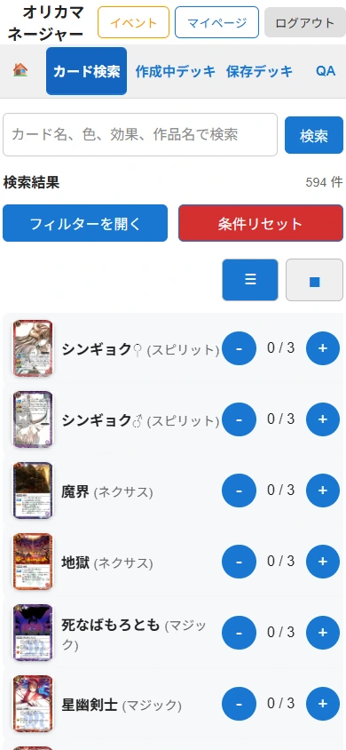
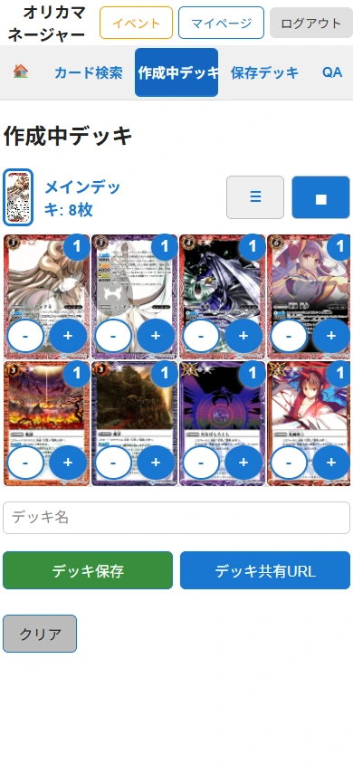

# オリカマネージャー

オリジナルカードを使ったデッキを組み、保存・共有・印刷用のファイル出力まで行える個人開発のWebアプリです。

本作は個人制作の同人作品で、非売品です。

## スマートフォンでの操作画面

| カード検索 | デッキ構築 |
| --- | --- |
|  |  |

## できること

- 色や種類でカードを絞り込み、一覧・グリッドから選んでデッキを組む。
- 保存済みデッキを検索・並べ替えし、共有URLやJSON・PNG・PDFで持ち出す。

## 開発で担当したこと

個人開発として、目的と仕様の整理、AIへの実装指示、改善方針の判断、動作確認を担当しました。コード作成にはAIを活用しています。

## 設計の工夫

- **カードを選ぶ画面の応答性を保つ。** 一覧で描画する行を絞る仮想スクロールを使い、検索結果や行データを再利用します。
- **PDFの処理を出力時まで遅らせる。** PDFライブラリは書き出し操作時に読み込み、初回に取得するファイルへ混ざっていないことを配布物の検査で確認します。[配布物の検査](scripts/check-distribution.mjs)
- **保存後もデッキを見つけやすくする。** 検索・並べ替えを画面から切り出し、保存済みデータに対する動作を個別にテストできるようにしています。[検索処理](src/utils/savedDeckFilters.js) · [並べ替えのテスト](src/utils/savedDeckSort.test.js)

**主な技術**　JavaScript、React、Vite、react-window、jsPDF

## 開発サーバー起動方法

```bash
npm ci
npm run dev
```

## ビルド方法
```
npm run build
```

## 性能改善とローカル検証（2026-10-08）

Node.js 22.12以降の22系を使用。

```sh
npm ci --ignore-scripts
npm run harness:preflight
npm run harness:check
```

`harness:check` はテスト・lint・ビルド・配布画像とPDF分割の検査を実行する。Node、開始時のHEAD、ソースのSHA-256、所要時間、成否を `.codex-temp/harness/latest.json` に記録し、検証中にソースが変われば失敗する。結果の再利用による検査省略はしない。開発ポートは5173（PORT指定可）に固定し、使用中なら停止する。

一覧・グリッドの行、検索結果、描画用データとコールバックを再利用し、採用枚数の参照にMapを使う。レイアウト・カードID・出力操作は維持。jsPDFはPDF操作時に読み込み、配布検査で初期読み込みに混入していないことを確認する。

本番用PNGは画素・寸法を照合した可逆WebPを生成し、小さくなる画像だけ画面の参照先を切り替える。657画像の画面向け合計は948,596,039バイトから573,874,606バイトへ39.5%削減。元PNGと既存の直接画像URLは従来どおり保持するため、dist全体の容量削減値ではない。変換キャッシュは.codex-temp/image-cache/で内容ハッシュを照合する。

npm testは既存の保存デッキ検索・ソートと画像URL互換を検証する。lintは既存警告8件（エラー0）を残しており、依頼外の挙動変更による警告解消は行っていない。

Chromiumの独立プロファイルで1280px／390pxの検索・枚数変更時の画像DOM維持・ゲストの保存と再読込・JSON／PNG／PDFダウンロード・PDF遅延読込を確認。外部リクエストはスタブ化したため、認証・クラウド保存・公式データの実接続やAndroid実機を確認したものではない。一時ブラウザ検証スクリプト・結果は作業用フォルダに保存し、配布物には含めない。

## 認証情報の混入防止

初回 clone 後は `npm run security:install` を実行してください。検査と検出時の対応は [SECURITY.md](SECURITY.md) を参照してください。

## 関連作品

- [幻想符 Simulator](https://github.com/shikuto3194/orica-simulator-interview)
- [ACGマネージャー](https://github.com/shikuto3194/acg-react-interview)
